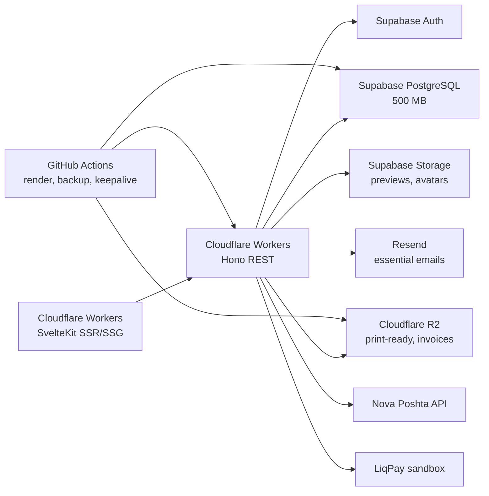

# Безкоштовний профіль розгортання

Мета: запустити «Дизайнер» на $0/місяць на вже обраних сервісах. Ліміти нижче орієнтовні станом на 2026 рік. Перед стартом перевірте актуальні сторінки тарифів, бо провайдери змінюють їх без попередження.

## 1. Ліміти, які нас стосуються

| Сервіс | Безкоштовний ліміт | Що це означає |
| --- | --- | --- |
| Cloudflare Workers | ~100 000 запитів/день, ~10 мс CPU на запит | Hono API і SvelteKit SSR. Каталог краще prerender-ити або кешувати. Важкий рендер зображень не працює |
| Cloudflare Pages | ~500 білдів/місяць | Опційні preview-деплої; production frontend — Workers |
| Cloudflare R2 | ~10 ГБ, 1 млн Class A, 10 млн Class B/місяць, egress без плати | Сховище для print-ready та рахунків |
| Supabase DB | ~500 МБ | 29 таблиць і текстові дані вміщаються. Файли не в БД |
| Supabase Storage | ~1 ГБ | Мало для print-ready. Тільки прев'ю, аватари, товарні фото |
| Supabase Auth | ~50 000 MAU | Достатньо |
| Supabase egress | ~5 ГБ/місяць | Каталог має бути WebP і кешований |
| Supabase pause | Проєкт засинає після ~7 днів без активності | Потрібен щоденний ping |
| Resend | ~100 листів/день, ~3 000/місяць | Тільки критичні листи |
| GitHub Actions | ~2 000 хвилин/місяць для private, публічні без ліміту | Render worker, backup, keep-alive |
| LiqPay | Sandbox без абонплати | Тестові платежі |
| Нова Пошта | API без абонплати | Тестові ЕН |

## 2. Що зламається на безкоштовному тирі

### 2.1 Print-ready рендер

`Cloudflare Workers` не має `node-canvas` і має 10 мс CPU. Поточний запис у специфікації «Fabric.js + node-canvas» не запуститься на чистому Workers.

Варіанти:

1. **GitHub Actions render worker (рекомендовано для точності).** Окремий workflow раз на 1-2 хвилини бере `print_jobs` зі статусом `queued`, рендерить Fabric.js + node-canvas, завантажує файли в R2, оновлює `print_files` і `print_jobs`. Латентність 1-3 хвилини, але 0 грн і той самий рушій, що у прев'ю.
2. **Client-side 300 DPI export (швидко, але менш захищено).** Frontend рендерить PNG через Fabric.js `toDataURL({ multiplier: 300 / 96 })`, завантажує як `print_file`, передає `printFileId` в замовлення. Backend перевіряє розміри, DPI і власника. Підходить для демо, але клієнт може підмінити файл.
3. **Cloudflare Browser Rendering або окремий Node-сервіс.** Найкраща якість і латентність, але безкоштовність треба перевірити; ймовірно платно.

Рекомендація: GitHub Actions для print-ready, client export як fallback для демо. У production повернутися до серверного рендера.

### 2.2 Місце в Supabase Storage

1 ГБ закінчиться за кілька десятків замовлень, якщо зберігати 300 DPI PNG.

- Supabase Storage: аватари, прев'ю, фото товарів, brand assets, списки імен. Це дрібні файли.
- Cloudflare R2: print-ready, direct/mirrored, PDF рахунків. `files.bucket` і `UploadTicket` уже провайдер-агностичні.
- Стиснення на клієнті: прев'ю до 1200 px WebP, фото товару до 1600 px WebP, artwork без стиснення.
- Retention: print-ready 30 днів після `delivered`, чернетки 90 днів, рахунки 3 роки, решта метаданих без обмежень.

### 2.3 Supabase засинає

Безкоштовний проєкт засинає після тижня без запитів. Додайте `GET /health` і щоденний GitHub Action ping. Endpoint уже є в OpenAPI. Це не замінює uptime-моніторинг, але не дає проєкту заснути.

### 2.4 Бекапи

На безкоштовному тарифі не покладайтеся на автоматичні бекапи. Додайте щоденний `pg_dump` у GitHub Action, результат у R2 або GitHub Artifacts. Для навчального проєкту достатньо щоденного дампу за останні 7 днів.

### 2.5 Черги та фонові задачі

Cloudflare Queues і Durable Objects можуть бути платними. Не закладайте їх у MVP.

- `print_jobs` уже є таблицею черги. Її читає GitHub Action або Cloudflare Cron Trigger.
- `notifications` можна використати як email outbox, додавши `email_status`, `email_attempts`, `email_sent_at`.
- Cleanup job: `idempotency_keys` старші 24 год, `notifications` старші 90 днів, `payment_events` старші 90 днів, `print_jobs` завершені старші 30 днів.

### 2.6 Resend 100/день

- Лише критичні листи: оплата, відправлення, доставка, рішення модерації, скидання пароля.
- Не надсилайте лист на кожне створення замовлення, якщо оплата ще не пройшла.
- Один лист на подію. Повторні webhook не повинні дублювати email.
- Налаштуйте Supabase Auth SMTP через Resend. Вбудований SMTP Supabase має малі ліміти.

### 2.7 Rate limit

Cloudflare Rate Limiting може бути обмежений на free plan. Для MVP:

- лічильники входу й upload у Cloudflare KV (безкоштовний ліміт малий, але для цих подій достатній);
- або таблиця `rate_limit_counters` у Supabase з TTL;
- не використовуйте Durable Objects/Queues тільки заради rate limit.

### 2.8 Трафік і кеш

- Публічні `GET` кешуються на edge: `Cache-Control: public, max-age=60, stale-while-revalidate=300`.
- Не повертайте повнорозмірні artwork у каталозі. Тільки WebP-прев'ю.
- Frontend не робить polling кожні 2 секунди. Оновлення на focus, після дії або через сповіщення.
- Пошук через `pg_trgm`, без Algolia.

## 3. Рекомендована безкоштовна архітектура



SvelteKit і Hono — окремі Worker-и. SvelteKit проксіює `/api/*` на API Worker, тому браузер бачить один origin. Публічний каталог краще prerender-ити або кешувати: безкоштовний Workers має ~10 мс CPU.

## 4. Зміни до контракту, які варто зробити

### P0

1. `GET /health` уже додано. Використовуйте його для keep-alive та uptime.
2. `files.expires_at` у `files`: дозволяє cleanup job знати, коли видаляти файл.
3. `print_files.source` enum `client|server|admin`: показує, як створено файл. Потрібно, якщо використовуєте client export.
4. `notifications.email_status` enum `pending|sent|failed|skipped`, `email_attempts`, `email_sent_at`: outbox для Resend.
5. `print_jobs.renderer` enum `github_actions|browser|client|admin`: діагностика, чому job упав.

### P1

6. Cleanup job для `idempotency_keys`, `notifications`, `payment_events`, `print_jobs`.
7. `files.storage_provider` enum `supabase|r2` або явні bucket names. Поле `bucket` уже є, але контракт має бути явним.
8. `GET /admin/health` або розширений `GET /health` з `checks.storage`, `checks.resend`. Не обов'язково для MVP.
9. `orders.print_ready_mode` enum `server|client`, якщо клієнтський експорт стане офіційним.

### P2

10. Окремий endpoint `POST /orders/{id}/print-files` для клієнтського 300 DPI файлу, якщо обираєте client export.
11. `invoices.storage_provider` або `pdf_file_id` уже достатньо; окреме поле не потрібне.

## 5. Зміни до NFR для безкоштовного профілю

| NFR | Було | Безкоштовний профіль |
| --- | --- | --- |
| NFR-05 print-ready | ≤ 15 с | ≤ 3 хв через GitHub Actions, ≤ 15 с через client export |
| NFR-41 зберігання | файли замовлень ≥ 12 міс | print-ready 30 днів, метадані замовлень без обмежень |
| NFR-13 ліміти файлів | 20/50/200 МБ | 10/25/50 МБ для free-tier, або 20/50/200 з R2 |
| NFR-16 бекапи | RPO ≤ 24 год | щоденний `pg_dump` у R2, RPO ≤ 24 год |
| NFR-15 доступність | ≥ 99,5% | best effort, без SLA на free plan |
| Email | усі шаблони | 4-5 критичних шаблонів, 100/день |

Це не змінює бізнес-логіку. Це профіль розгортання для навчального проєкту.

## 6. Що не додавати

- Cloudflare Queues і Durable Objects, якщо вони платні на вашому плані.
- Redis/Upstash, Algolia, Supabase Realtime, Kubernetes.
- Окремий мікросервіс для кожного домену.
- Важкий image processing у Workers.
- Власний SMTP-сервер.

## 7. Чек-лист запуску

1. Supabase: створити проєкт, застосувати `database/schema.sql`, увімкнути Auth, налаштувати SMTP Resend.
2. Cloudflare: створити Workers для frontend і API, R2 bucket, env vars. `service_role` тільки в Workers secrets.
3. R2: bucket `print-files`, `invoices`, lifecycle 30 днів для print, CORS для signed upload.
4. GitHub: secrets `SUPABASE_URL`, `SUPABASE_SERVICE_ROLE_KEY`, `R2_*`, `RESEND_API_KEY`, `LIQPAY_*`, `NOVA_POSHTA_*`.
5. GitHub Actions: keepalive, db-backup, render-worker.
6. LiqPay: sandbox keys і test card.
7. Нова Пошта: test API key.
8. UptimeRobot або Cloudflare Health Check на `/health`.
9. Sentry free для frontend і Workers.
10. Перевірити, що жоден секрет не потрапив у frontend bundle.

## 8. Приклади GitHub Actions

### Keep-alive

```yaml
name: keepalive
on:
  schedule:
    - cron: "17 3 * * *"
  workflow_dispatch:
jobs:
  ping:
    runs-on: ubuntu-latest
    steps:
      - name: Ping health
        run: curl -fsS https://api.designer.r0ma.top/health
```

### Backup

```yaml
name: db-backup
on:
  schedule:
    - cron: "23 2 * * *"
  workflow_dispatch:
jobs:
  dump:
    runs-on: ubuntu-latest
    steps:
      - name: Install client
        run: sudo apt-get update && sudo apt-get install -y postgresql-client
      - name: Dump
        run: pg_dump "$DATABASE_URL" -Fc -f backup.dump
        env:
          DATABASE_URL: ${{ secrets.SUPABASE_DB_URL }}
      - name: Upload to R2
        run: aws s3 cp backup.dump "s3://$BUCKET/db/$(date +%F).dump" --endpoint-url "$ENDPOINT"
        env:
          AWS_ACCESS_KEY_ID: ${{ secrets.R2_ACCESS_KEY_ID }}
          AWS_SECRET_ACCESS_KEY: ${{ secrets.R2_SECRET_ACCESS_KEY }}
          BUCKET: ${{ secrets.R2_BUCKET }}
          ENDPOINT: ${{ secrets.R2_ENDPOINT }}
```

### Render worker, каркас

```yaml
name: print-render
on:
  schedule:
    - cron: "*/2 * * * *"
  workflow_dispatch:
jobs:
  render:
    runs-on: ubuntu-latest
    steps:
      - uses: actions/checkout@v4
      - uses: actions/setup-node@v4
        with:
          node-version: 20
      - run: npm ci
      - run: node scripts/render-print-jobs.mjs
        env:
          SUPABASE_URL: ${{ secrets.SUPABASE_URL }}
          SUPABASE_SERVICE_ROLE_KEY: ${{ secrets.SUPABASE_SERVICE_ROLE_KEY }}
          R2_ENDPOINT: ${{ secrets.R2_ENDPOINT }}
          R2_ACCESS_KEY_ID: ${{ secrets.R2_ACCESS_KEY_ID }}
          R2_SECRET_ACCESS_KEY: ${{ secrets.R2_SECRET_ACCESS_KEY }}
          R2_BUCKET: ${{ secrets.R2_BUCKET }}
```

`render-print-jobs.mjs` має взяти до 10 queued jobs, зрендерити через Fabric.js + node-canvas, завантажити direct і mirrored, оновити `print_files` і `print_jobs`, і завершитися. Не робіть один job на замовлення, якщо в замовленні 50 імен: групуйте.

## 9. Очікувана вартість

| Стаття | Вартість |
| --- | --- |
| Cloudflare Workers, R2 | $0 у межах лімітів |
| Supabase DB, Auth, Storage | $0 у межах лімітів |
| Resend | $0 до 100 листів/день |
| GitHub Actions | $0 у межах 2 000 хв або публічний репозиторій |
| LiqPay sandbox, Нова Пошта test | $0 |
| Домен | окремо, `designer.r0ma.top` |

## 10. Ризики

1. Free-tier ліміти можуть змінитися. Перевіряйте перед демо.
2. GitHub Actions render має латентність і залежить від доступності GitHub.
3. Supabase free не дає SLA і може заснути, якщо keep-alive зламається.
4. R2 додає ще один SDK і ключі. Тримайте їх тільки в GitHub/Cloudflare secrets.
5. Client-side print export можна підмінити. Для навчального демо це прийнятно, для production ні.
6. Resend 100/день легко перевищити при масовій модерації. Групуйте листи.
