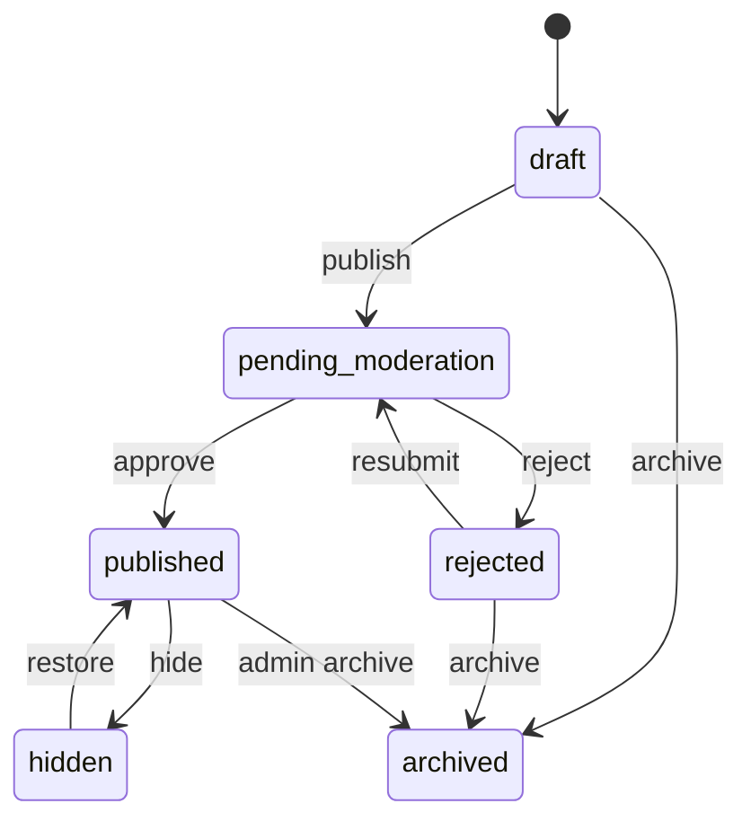
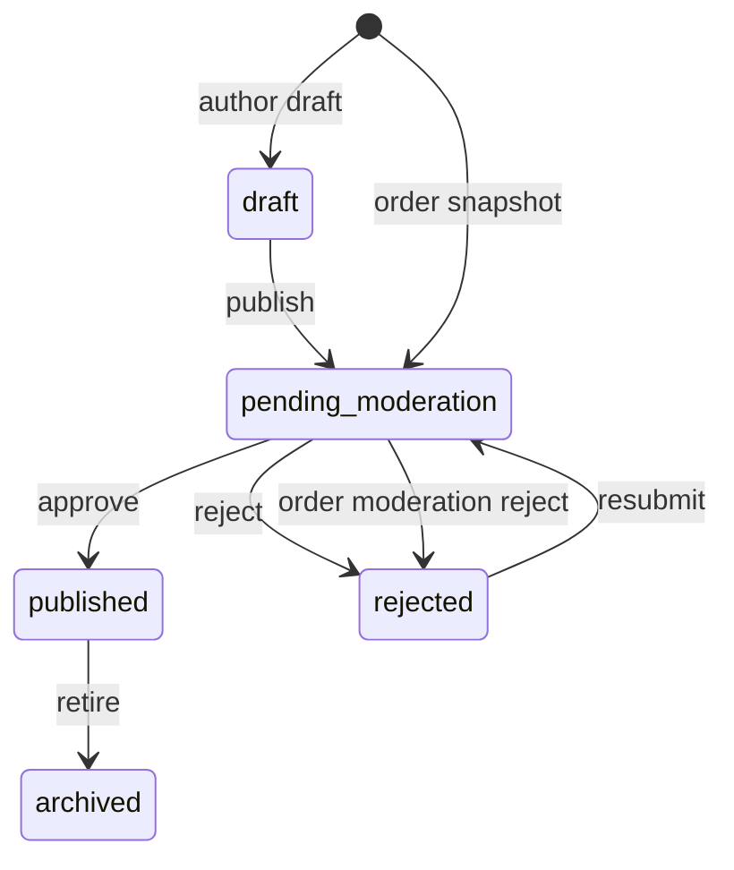
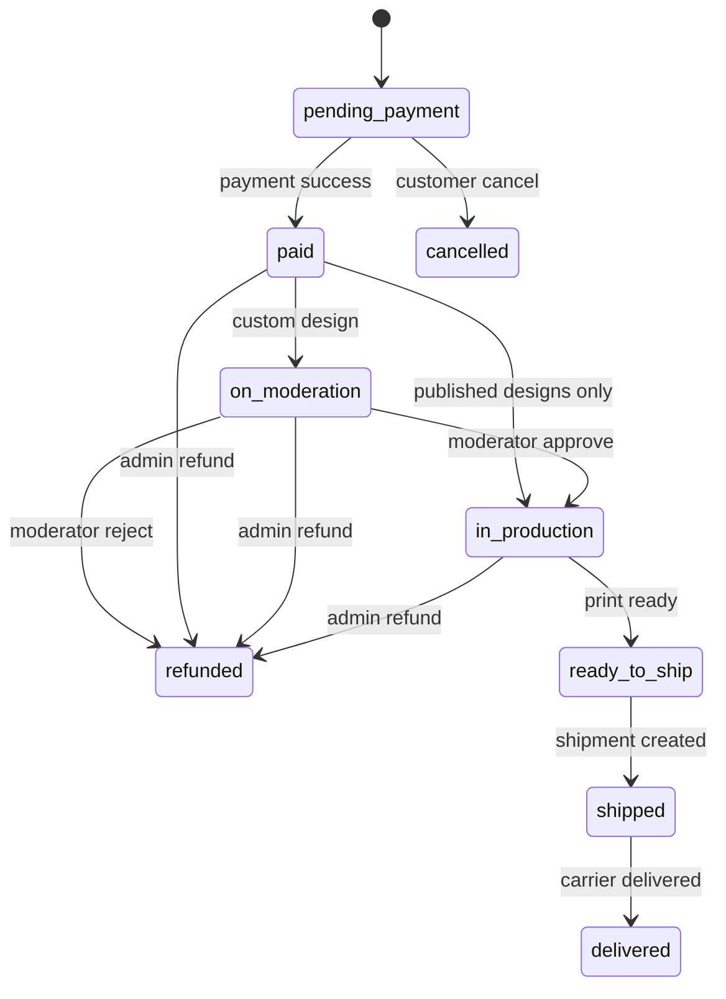
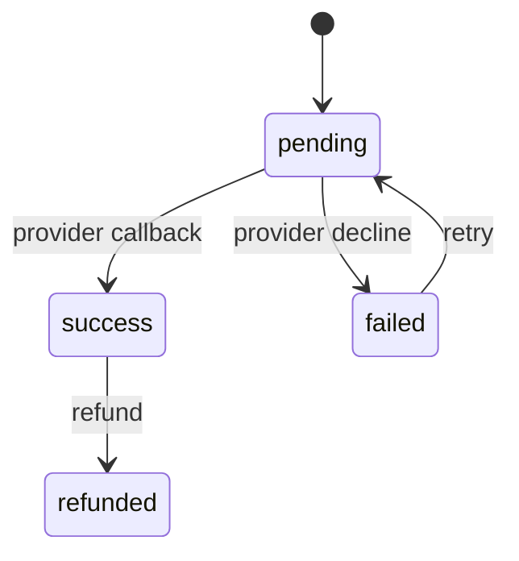
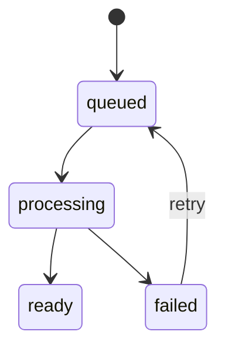

# Специфікація продукту «Дизайнер»

Версія: 1.0
Дата: 05.11.2026
Команда: «Стиляги»
Дисципліна: «Управління ІТ-проєктами», ЧНУ

Документ зводить воєдино Product Vision v1.1, SRS, Requirements, NFR Specification, Product Backlog, Use Case Specification, User Roles, User Personas, бізнес-правила та діаграми з папки `Team_4_2026`. Він є джерелом істини для двох команд: frontend і backend. Схема БД та OpenAPI є похідними від цього документа.

| Версія | Дата | Автор | Зміна |
| --- | --- | --- | --- |
| 1.0 | 05.11.2026 | Команда «Стиляги» | Консолідація всіх матеріалів, фіксація TBD, узгодження з БД і OpenAPI |

## 0. Статус і джерела

| Джерело | Що взято |
| --- | --- |
| Product Vision v1.1 | Бачення, цільові групи, ролі, MVP, KPI, ризики |
| Requirements | Стек, браузери, CRUD-матриця, NFR, UI flow |
| SRS | FR-01...FR-14, класи користувачів, межі |
| NFR Specification | 11 категорій NFR з метриками та перевіркою |
| Product Backlog | US01...US25, Sprint I...VII, v1.0 та v1.1 |
| Use Case Specification | UC01...UC28 |
| User Roles | Гость, покупець, автор, модератор, адміністратор, супер-адміністратор |
| User Personas | Олена, Андрій, Максим |
| ER Diagram | Базові сутності `USERS`, `BASE_PRODUCTS`, `DESIGNS`, `ORDERS`, `ORDER_ITEMS`, `PAYMENTS`, `MODERATION_LOGS` |
| System Architecture | SvelteKit SSR/SSG, Fabric.js, Hono на Cloudflare Workers, Supabase Auth/Storage/PostgreSQL |

Рішення, які в джерелах були позначені як TBD, зафіксовані в розділі 2.4. Якщо команда змінює рішення, змінюється цей документ, потім `openapi.yaml`, потім `schema.sql`.

## 1. Огляд продукту

### 1.1 Проблема

Покупцеві потрібен простий браузерний інструмент, щоб зробити річ із власним принтом і побачити результат до оплати. Авторові потрібен спосіб продавати принти без закупівлі тиражу, складу та логістики. Малому бізнесу потрібен брендований мерч партіями від 10 до 500 одиниць без ручного листування з друкарнею. Друкарні потрібні готові файли із передбачуваними параметрами.

### 1.2 Продукт

Терміни: **товар** це базова позиція каталогу (футболка, худі, чашка) з варіантами кольору й розміру; **дизайн** це макет на полотні; **опублікований дизайн** це дизайн, прив'язаний до товару, який покупець може замовити або взяти за основу.

«Дизайнер» це вебплатформа, яка поєднує:

- каталог базових товарів (футболки, худі, чашки та інші позиції, які додає адміністратор);
- 2D-конструктор на Fabric.js із зоною друку, шарами, текстом і завантаженими зображеннями;
- каталог авторських принтів із модерацією;
- оформлення замовлення, онлайн-оплату або рахунок-фактуру, доставку Новою Поштою;
- автоматичну генерацію print-ready файлів на 300 DPI;
- B2B-сценарії: векторний логотип, пробний зразок, прогресивна знижка, персоналізація тиражу списком імен;
- робочі панелі модератора й адміністратора.

### 1.3 Цільові групи

| Група | Персона | Головна потреба |
| --- | --- | --- |
| Індивідуальний покупець | Олена | Створити подарунок за 5 хвилин, побачити прев'ю, отримати якісний друк |
| Бізнес-клієнт | Андрій | Замовити партію з логотипом, пробний зразок, знижку та рахунок |
| Автор дизайну | Максим | Опублікувати принт, пройти модерацію, бачити статистику та винагороду |
| Модератор | Ірина | Швидко перевірити DPI, права та скарги |
| Адміністратор | Олексій | Керувати каталогом, замовленнями, друком і користувачами |

### 1.4 Ролі та права

Роль визначає доступ до API. Автор і бізнес-клієнт не є окремими ролями: будь-який покупець може опублікувати дизайн або заповнити реквізити компанії. Це відповідає правилу «один обліковий запис може бути покупцем і дизайнером».

| Дія | Гість | Покупець | Модератор | Адміністратор |
| --- | --- | --- | --- | --- |
| Каталог, товари, опубліковані дизайни | Так | Так | Так | Так |
| Реєстрація, вхід | Так | Так | Так | Так |
| Конструктор, чернетки, публікація | Ні | Свої | Читання | Читання |
| Замовлення, оплата, історія | Ні | Свої | Читання | Усі |
| B2B-реквізити, рахунок, персоналізація | Ні | Так | Читання | Читання |
| Модерація дизайнів і замовлень | Ні | Ні | Так | Так |
| Каталог, знижки, зони друку | Ні | Ні | Ні | Так |
| Статуси замовлень, друк, відправлення | Ні | Ні | Ні | Так |
| Користувачі, ролі, аудит | Ні | Ні | Ні | Так |

`super_admin` зарезервований для майбутніх системних налаштувань. У MVP він не має окремих екранів і використовує API адміністратора.

Права повертаються у `GET /auth/me` як масив `permissions`: `catalog:read`, `design:write`, `design:publish`, `order:write`, `company:write`, `moderation:review`, `admin:catalog`, `admin:orders`, `admin:users`, `admin:analytics`. Frontend ховає кнопки за цим масивом, але backend перевіряє роль повторно.

### 1.5 Технологічний стек

| Шар | Технології |
| --- | --- |
| Frontend | SvelteKit 3, Svelte 5, TypeScript, Vite, Fabric.js 6, Tailwind CSS |
| Backend | Hono, TypeScript, Cloudflare Workers, Zod для валідації, JWT guard |
| Дані | Supabase PostgreSQL 15+, Supabase Auth, Supabase Storage |
| Платежі | LiqPay hosted page, adapter `PaymentProvider` |
| Доставка | Нова Пошта API |
| Email | Resend |
| CI/CD | GitHub Actions, Cloudflare Workers, Wrangler |
| Локально | Supabase hosted, `wrangler dev`, `vite dev` |

### 1.6 Бізнес-цілі та KPI

| Метрика | Ціль | Період |
| --- | --- | --- |
| Оборот | ≥ $15 000 на місяць (гіпотеза, приблизно 600 замовлень по $25) | Після запуску |
| Беззбитковість | 9 місяців | Після запуску |
| Час створення макета | ≤ 5 хвилин для нового користувача | Юзабіліті-тест |
| Конверсія відвідувач -> замовлення | 1...2% на старті | Щомісяця |
| Частка замовлень із print-ready файлом | 100% | Щомісяця |
| Опубліковані авторські принти | ≥ 50 за перші 3 місяці | Щомісяця |

### 1.7 Глосарій

| Термін | Значення |
| --- | --- |
| MVP | Мінімально життєздатна версія продукту |
| POD | Print-on-Demand, виготовлення після оплати |
| Mockup | Прев'ю дизайну на товарі |
| Print-ready | Файл, підготовлений до виробничого друку |
| DPI | Роздільна здатність зображення для друку |
| B2B | Замовлення від бізнес-клієнта |
| RLS | Row Level Security у PostgreSQL |
| Idempotency-Key | Ключ, що робить повторний запит безпечним |

## 2. Межі релізів

### 2.1 v1.0 MVP

US01...US12, US24, US25.

- Каталог, реєстрація, вхід, профіль.
- 2D-конструктор: зображення, текст, масштаб, поворот, шари, undo/redo, чернетки.
- Перевірка DPI, фінальне прев'ю, disclaimer.
- Вибір розміру й кольору, кошик, оформлення, онлайн-оплата, історія замовлень.
- B2B: векторний логотип, пробний зразок, знижки за кількість.
- Адмін: товари, варіанти, зони друку, базові статуси замовлень.
- Мінімальне схвалення кастомних замовлень адміністратором перед друком. Повна черга дизайнів, скарги та окрема роль модератора входять у v1.1.

### 2.2 v1.1

US13...US23.

- Рахунок-фактура PDF для оплати банківським переказом.
- Публікація дизайнів, назва, опис, теги, підтвердження прав.
- Повна черга модерації дизайнів і замовлень, окрема роль модератора, рішення з причиною, скарги.
- Список імен для персоналізації тиражу, перевірка найдовшого імені.
- Автоматичне віддзеркалення файлів для термопереносу, групування черги друку за тканиною, кольором і розміром.
- Статистика автора, сповіщення, журнал дій.

### 2.3 Поза межами продукту

- 3D-рендеринг, AR-примірка, нативні застосунки iOS/Android.
- Автоматичні виплати роялті на картки авторів. У v1.1 є облік винагороди, виплати виконуються вручну.
- Повноцінний багатокористувацький B2B-кабінет із договорами, відстрочкою та API.
- Власне виробництво, склад і логістика. Використовуються партнерські друкарні.
- Відгуки, рейтинги та обране. У джерелах вони є в бізнес-правилах, але не мають жодної user story або acceptance criteria. Картка товару не показує рейтинг у v1.0 та v1.1.
- Промокоди. Поле є у варфреймі кошика, але правила й story відсутні. У MVP поле не показується.

### 2.4 Зафіксовані рішення щодо TBD

| Питання | Рішення |
| --- | --- |
| Платіжний провайдер | LiqPay як єдиний активний провайдер MVP. Інтерфейс `PaymentProvider` дозволяє додати WayForPay без зміни API. Провайдер зберігається в `payments.provider`. |
| Доставка | Нова Пошта: довідник міст, відділень і поштоматів, створення ЕН, трекінг. |
| Email | Resend. Шаблони: підтвердження замовлення, оплата, відправлення, рішення модерації, рахунок, скидання пароля. |
| Формати та ліміти | PNG/JPEG/SVG до 20 МБ; AI/EPS до 50 МБ; CSV/XLSX зі списком до 5 МБ; print-ready PNG/PDF до 200 МБ. |
| DPI | Ефективний DPI < 72: блокування додавання в кошик. 72...149: попередження. 150 і більше: норма. |
| Шрифти | Рівно 5 захардкожених шрифтів: `inter`, `montserrat`, `pt_serif`, `bitter`, `caveat`. Усі з кирилицею. Файли лежать у `assets/fonts`, список і URL повертає `GET /config`. |
| Знижки | 10+ шт: 5%; 50+ шт: 10%; 100+ шт: 15%. Значення зберігаються в `discount_tiers` і можуть бути перевизначені для товару. |
| Винагорода автора | 10% від суми рядка після знижки. Налаштовується в межах 0...30%. Нарахування фіксується в `author_bonuses`, автоматичних виплат немає. |
| Рахунок-фактура | PDF, номер `INV-YYYY-NNNNNN`, термін оплати 3 дні, реквізити компанії з `company_profiles`. |
| Модерація | Обов'язкова премодерація дизайнів. SLA 24 години. Замовлення з кастомними дизайнами проходять модерацію після оплати. |
| Скасування | Покупець скасовує лише `pending_payment`. Адміністратор скасовує або повертає кошти до `in_production`. Після `ready_to_ship` скасування неможливе. |
| Гостьова оплата | Не підтримується. Додавання в кошик і оформлення вимагають входу, як у негативному сценарії US01. |
| Кошик | Зберігається на клієнті (Zustand + localStorage). Серверного кошика немає. Ціни та знижки перевіряються через `POST /cart/quote` і повторно в `POST /orders`. |
| Валюта | UAH. Гроші в API та БД зберігаються цілими мінорними одиницями (копійками) у полях `*Minor`. |
| Мови | Українська за замовчуванням, англійська для інтерфейсу. Контент користувача не перекладається. |

## 3. Користувацькі сценарії

### 3.1 Індивідуальне замовлення

1. Гість відкриває каталог, фільтрує товари, відкриває картку.
2. Обирає колір, розмір, натискає «Створити дизайн».
3. У конструкторі завантажує PNG/JPEG/SVG, додає текст, змінює масштаб, поворот і порядок шарів.
4. Система перевіряє формат, розмір файлу та ефективний DPI. Якщо DPI < 72, кнопка кошика заблокована.
5. Покупець бачить прев'ю без сіток, ставить disclaimer, додає товар у кошик.
6. У кошику бачить ціну, знижку за кількість, доставку.
7. Вводить ПІБ, телефон, обирає місто й відділення Нової Пошти.
8. Обирає оплату карткою. Система створює замовлення `pending_payment` і платіжне посилання.
9. Після успішного webhook замовлення стає `paid`, потім `on_moderation` (якщо дизайн кастомний) або `in_production`.
10. Модератор перевіряє макет. Після схвалення генерується print-ready файл, адміністратор друкує й створює ЕН.
11. Покупець отримує email і сповіщення на кожному переході.

### 3.2 Купівля авторського принта

1. Покупець відкриває опублікований дизайн у каталозі.
2. Обирає товар-основу, колір і розмір.
3. Може замовити як є або натиснути «Взяти за основу», щоб отримати власну чернетку з `forkedFromId`.
4. Після редагування публікувати не потрібно: замовлення може містити приватний дизайн.
5. Автор кореневого дизайну отримує 10% від суми рядка. Якщо покупець і автор це одна людина, винагорода не нараховується.

### 3.3 B2B-замовлення

1. Покупець заповнює `company_profiles`: назва, ЄДРПОУ, IBAN, банк, юридична адреса, контакт.
2. Завантажує логотип AI/EPS у бібліотеку бренду.
3. Обирає товар, кількість 10...500, бачить прогресивну знижку.
4. Для пробного зразка натискає «Замовити зразок»: кількість 1, знижка 0.
5. Для тиражу з іменами завантажує CSV/XLSX, система перевіряє кількість імен і найдовше ім'я.
6. Обирає оплату карткою або банківським переказом.
7. Для банківського переказу отримує PDF-рахунок із реквізитами та терміном 3 дні.
8. Адміністратор підтверджує надходження коштів, замовлення переходить у `paid`.

### 3.4 Публікація та модерація

1. Автор створює дизайн, заповнює назву (3...60 символів), опис (до 300), теги.
2. Підтверджує права на зображення. Фіксується користувач, час і версія тексту.
3. Дизайн отримує `pending_moderation` і з'являється в черзі.
4. Модератор бачить прев'ю, DPI, розмір у пікселях, підтвердження прав і кількість скарг.
5. Схвалення: `published`, дизайн у каталозі. Відхилення: `rejected` з обов'язковою причиною, автор отримує email і сповіщення.
6. Скарга на опублікований дизайн створює `design_reports`. Модератор відхиляє скаргу або приховує дизайн (`hidden`) і повідомляє автора.

### 3.5 Адміністративний сценарій

1. Адміністратор створює категорію, товар, варіанти кольорів і розмірів, зони друку, знижки.
2. Бачить чергу друку, фільтрує за тканиною, кольором, розміром.
3. Перевіряє print-ready файли. Якщо генерація не вдалася, бачить помилку й повторює job.
4. Змінює статус замовлення, створює ЕН, підтверджує банківський переказ або повернення.
5. Керує користувачами, блокує порушників, переглядає аудит.

## 4. Функціональні вимоги

Позначення: FR це функціональна вимога. Кожна вимога має acceptance criteria у форматі Given/When/Then або чітке правило.

### 4.1 Каталог і пошук

| ID | Вимога | Acceptance criteria |
| --- | --- | --- |
| FR-01 | Гість переглядає категорії, товари та опубліковані дизайни без входу | Given гість відкрив каталог, When він гортає або фільтрує, Then дані доступні без токена. Спроба додати в кошик повертає 401 і редирект на вхід |
| FR-02 | Пошук і фільтри | Given є товари й дизайни, When застосовано `q`, `categoryId`, `productId`, `authorId`, `sort`, Then повертається посторінковий результат. Порожній результат має `total=0`, а не помилку |
| FR-03 | Картка товару | Given товар активний, When відкрито картку, Then видно опис, ціну, варіанти, зони друку, фото. Неактивний товар повертає 404 для гостя |
| FR-04 | Картка дизайну | Given дизайн `published`, When відкрито картку, Then видно автора, прев'ю, базовий товар, кількість замовлень. Дизайн в іншому статусі бачить лише власник або персонал |

### 4.2 Акаунт і профіль

| ID | Вимога | Acceptance criteria |
| --- | --- | --- |
| FR-05 | Реєстрація | Given унікальний email і пароль ≥ 8 символів із цифрою, When надіслано форму, Then створюється `auth.users` і профіль `public.users` із роллю `customer`. Повторний email повертає 409 |
| FR-06 | Вхід і сесія | Given правильні дані, When вхід, Then access token на 15 хв у тілі, refresh token на 7 діб у HttpOnly cookie. 10 невдалих спроб за хвилину з IP блокуються на 1 хв |
| FR-07 | Відновлення пароля | Given існуючий email, When запит відновлення, Then відповідь 204 незалежно від наявності акаунта. Лист містить одноразове посилання |
| FR-08 | Профіль | Given користувач авторизований, When змінює ПІБ, телефон, мову або аватар, Then зміни зберігаються. Змінити роль або статус через профіль неможливо |
| FR-09 | Видалення акаунта | Given підтвердження `DELETE`, When запит видалення, Then акаунт блокується, персональні дані анонімізуються протягом 30 днів, замовлення зберігаються для бухгалтерії |

### 4.3 Конструктор

| ID | Вимога | Acceptance criteria |
| --- | --- | --- |
| FR-10 | Створення чернетки | Given покупець авторизований, When відкриває конструктор товару, Then створюється `designs` зі статусом `draft`, прив'язаний до товару й зони друку |
| FR-11 | Завантаження зображень | Given файл PNG/JPEG/SVG ≤ 20 МБ і ≥ 1000x1000 px, When завантаження, Then файл стає `ready` і додається як окремий `ImageObject`. Можна додати кілька зображень; кожне має власні `fileId`, позицію, масштаб, поворот, flip і z-index. Інший формат або розмір повертає 415/413 |
| FR-12 | Smart textbox | Given полотно відкрите, When додано `TextboxObject` до 100 символів, Then доступні 5 захардкожених шрифтів із кирилицею, палітра кольорів, перенос тексту в межах width/height, вирівнювання, line-height, char-spacing, жирність, курсив і padding. Порожній текст не додається |
| FR-13 | Шари, поворот і історія | Given на полотні є об'єкти, When змінюється порядок або кут, Then z-order і `angle` зберігаються в canvas JSON. `angle` приймає будь-який кут від -360 до 360 і нормалізується до [0, 360). Undo/redo працює на клієнті |
| FR-13a | Обмеження canvas | Given один дизайн, When додаються об'єкти, Then максимум 20 об'єктів різних типів (image, textbox, shape). Кожен об'єкт незалежно переміщується, масштабується, повертається і змінює z-index |
| FR-13b | Паритет прев'ю і друку | Given canvas із кількома image і textbox, When генерується print-ready файл, Then backend рендерить ті самі Fabric.js об'єкти тими самими 5 font-файлами. Перенос, вирівнювання, поворот і позиція збігаються з прев'ю |
| FR-13c | Версійність | Given дизайн замовлено, When минає час або автор редагує чернетку, Then позиція замовлення посилається на незмінний `designVersionId`, а не на поточний `designs.canvas`. Друк використовує саме цю версію |
| FR-14 | Межі зони друку | Given зона друку задана в мм, When об'єкт виходить за межі, Then він обмежується або підсвічується, а сервер відхиляє такий canvas при публікації та замовленні |
| FR-15 | Перевірка DPI | Given зображення на полотні, When ефективний DPI < 72, Then кошик заблокований. 72...149: попередження. ≥ 150: норма |
| FR-16 | Прев'ю | Given у макеті є елементи, When натиснуто «Перегляд», Then сітки й напрямні приховані, показується mockup товару |
| FR-17 | Автозбереження | Given редагування, When минає 30 секунд, Then чернетка зберігається. Втрата при закритті вкладки не більше 30 секунд |
| FR-18 | Використання чужого принта | Given дизайн `published`, When покупець натискає «Взяти за основу», Then створюється приватна чернетка з `forkedFromId`, автор кореня отримує винагороду при замовленні |

### 4.4 Замовлення та оплата

| ID | Вимога | Acceptance criteria |
| --- | --- | --- |
| FR-19 | Кошик | Given товар із дизайном, When додано в кошик, Then кошик зберігається на клієнті. Серверна ціна перевіряється через quote |
| FR-20 | Розрахунок ціни | Given кількість і товар, When quote або checkout, Then ціна = базова ціна + дельта варіанта, знижка за шкалою, доставка. Усі суми в копійках |
| FR-21 | Оформлення | Given кошик і disclaimer, When checkout, Then створюється `orders` з `pending_payment`, `order_items` з `designVersionId`, платіж або рахунок. Для опублікованого дизайну береться `currentVersionId`, для приватної чернетки створюється `order_snapshot`. Без disclaimer повертається 422 |
| FR-22 | Онлайн-оплата | Given картка, When платіж успішний, Then webhook ідемпотентно переводить `payments.status=success`, `orders.status=paid`. Повторний webhook не створює дубль |
| FR-23 | Банківський переказ | Given `paymentMethod=bank_transfer` і заповнені реквізити, When checkout, Then створюється рахунок PDF. Без реквізитів повертається 422 `COMPANY_PROFILE_INCOMPLETE` |
| FR-24 | Історія замовлень | Given покупець авторизований, When відкриває історію, Then бачить лише свої замовлення зі статусами й деталями. Чуже замовлення повертає 404 |
| FR-25 | Скасування | Given `pending_payment`, When покупець скасовує, Then статус `cancelled`. Після оплати скасування лише через адміністратора |

### 4.5 B2B

| ID | Вимога | Acceptance criteria |
| --- | --- | --- |
| FR-26 | Реквізити компанії | Given покупець заповнює `companyProfiles`, When зберігає, Then обов'язкові поля валідуються. Рахунок використовує snapshot реквізитів |
| FR-27 | Векторний логотип | Given AI/EPS ≤ 50 МБ, When завантаження, Then файл доступний у бібліотеці бренду. JPEG замість вектора дає попередження, але не блокує |
| FR-28 | Пробний зразок | Given товар, When «Замовити зразок», Then кількість 1, знижка 0, ціна роздрібна. Спроба змінити кількість повертає 422 |
| FR-29 | Прогресивна знижка | Given кількість 10/50/100, When quote, Then знижка 5/10/15% застосовується до рядка. Нижче 10 знижка 0 |
| FR-30 | Список імен | Given CSV/XLSX до 500 імен, When завантаження, Then порожні рядки відхиляються з номерами. Кількість імен дорівнює кількості товару |
| FR-31 | Перевірка найдовшого імені | Given список і текстовий елемент, When валідація, Then система повертає `fits`, найдовше ім'я та рекомендований розмір шрифту. Мінімум 8 pt |

### 4.6 Авторські дизайни

| ID | Вимога | Acceptance criteria |
| --- | --- | --- |
| FR-32 | Публікація | Given чернетка з назвою, описом і підтвердженням прав, When публікація, Then створюється незмінна `design_versions` зі статусом `pending_moderation`, а дизайн отримує цей статус. Повторна публікація вже опублікованого дизайну повертає 409. Без прав API повертає 422 |
| FR-33 | Статус модерації | Given автор подав дизайн, When відкриває «Мої дизайни», Then бачить `pending_moderation`, `published`, `rejected` або `hidden` з причиною |
| FR-34 | Сповіщення про відхилення | Given модератор відхилив дизайн, When статус змінився, Then автор отримує email і in-app сповіщення з причиною |
| FR-35 | Статистика | Given автор має опубліковані дизайни, When відкриває статистику, Then бачить перегляди, замовлення, копії та нараховану винагороду |

### 4.7 Модерація

| ID | Вимога | Acceptance criteria |
| --- | --- | --- |
| FR-36 | Черга дизайнів | Given є `pending_moderation`, When модератор відкриває чергу, Then бачить елементи з DPI, правами, скаргами, прев'ю |
| FR-37 | Рішення | Given елемент черги з конкретною `versionId`, When `approve` або `reject`, Then змінюється статус версії, причина відхилення обов'язкова, автор повідомлений. Схвалена версія стає `currentVersionId` дизайну |
| FR-38 | Скарги | Given опублікований дизайн, When скарга, Then створюється `design_reports`. Модератор відхиляє скаргу або приховує дизайн |
| FR-39 | Черга замовлень | Given оплачене замовлення з кастомним дизайном, When модератор відкриває чергу, Then бачить макети. Схвалення переводить у `in_production`, відхилення скасовує з поверненням |

### 4.8 Адміністрування

| ID | Вимога | Acceptance criteria |
| --- | --- | --- |
| FR-40 | Каталог | Given адміністратор, When створює або редагує товар, Then зберігаються варіанти, зони друку, фото, знижки. Ціна > 0, хоча б один варіант |
| FR-41 | Черга друку | Given замовлення `in_production`, When адміністратор фільтрує за тканиною, кольором, розміром, Then бачить згруповані позиції |
| FR-42 | Файли друку | Given позиція замовлення, When адміністратор додає прямий або дзеркальний файл, Then файл прикріплюється зі статусом `ready`. Дзеркальна версія генерується автоматично |
| FR-43 | Статуси замовлень | Given замовлення, When адміністратор змінює статус, Then перехід відповідає state machine. Недозволений перехід повертає 409 |
| FR-44 | Відправлення | Given `ready_to_ship`, When створюється ЕН, Then `shipments` містить трек-номер, статус `shipped`, покупець отримує сповіщення |
| FR-45 | Користувачі | Given адміністратор, When блокує або змінює роль, Then дія фіксується в `audit_logs`. Заблокувати себе або останнього адміністратора неможливо |
| FR-46 | Аналітика | Given період, When адміністратор відкриває дашборд, Then бачить замовлення, виторг, середній чек, черги, топ товарів і дизайнів |

### 4.9 Сповіщення

| ID | Вимога | Acceptance criteria |
| --- | --- | --- |
| FR-47 | In-app | Given подія, When вона відбулася, Then `notifications` містить запис для користувача. Непрочитані мають `readAt=null` |
| FR-48 | Email | Given подія, When є email, Then Resend надсилає лист за шаблоном. Помилка email не відкочує бізнес-операцію, але пишеться в лог |

## 5. Бізнес-правила

### 5.1 Ціни

- `unitPriceMinor = product.basePriceMinor + variant.priceDeltaMinor`.
- `lineSubtotalMinor = unitPriceMinor * quantity`.
- `discountPercent` визначається найвищим tier, де `quantity >= minQuantity`. Tier товару має приоритет над глобальним.
- `lineDiscountMinor = round(lineSubtotalMinor * discountPercent / 100)`.
- `lineTotalMinor = lineSubtotalMinor - lineDiscountMinor`.
- `order.subtotalMinor = sum(lineSubtotalMinor)`, `order.discountMinor = sum(lineDiscountMinor)`, `order.totalMinor = subtotal - discount + deliveryCostMinor`.
- Округлення half-up до копійки. Floating point не використовується.
- Пробний зразок: `quantity=1`, `discountPercent=0`, `isSample=true`.
- Ціни фіксуються в `order_items` на момент замовлення. Зміна каталогу не змінює старе замовлення.
- `payments.amount_minor` мусить дорівнювати `orders.total_minor`. Webhook із іншою сумою відхиляється, пишеться в `payment_events`, замовлення не стає `paid`.
- Доступність товару визначають `products.is_active`, `product_variants.is_active` і `product_variants.stock_quantity`. Нульовий залишок означає «розпродано», вимкнений варіант не показується в каталозі.
- Запас резервується атомарно в `POST /orders` одним `UPDATE ... WHERE stock_quantity >= qty`. Нуль оновлених рядків означає 409 `OUT_OF_STOCK`.
- Якщо оплата не надійшла, запас повертається один раз, а `orders.stock_released_at` фіксує час. Карткове замовлення без оплати скасовується через 30 хвилин. Банківське замовлення скасовується після `invoices.due_at` (3 дні).

### 5.2 Canvas, зображення та DPI

- Ефективний DPI = `imageWidthPx / (printedWidthMm / 25.4)`.
- < 72: `DPI_TOO_LOW`, додавання в кошик і checkout блокуються.
- 72...149: попередження `DPI_WARNING`, checkout дозволений після підтвердження.
- ≥ 150: без попередження.
- Мінімальний розмір файлу 1000x1000 px. SVG перевіряється на відсутність зовнішніх ресурсів і скриптів.
- Формати: PNG, JPEG, SVG для artwork; AI, EPS для vector; PNG, PDF для print file.

Canvas підтримує:

- декілька `ImageObject` на одному дизайні. Кожен має власні `fileId`, `left`, `top`, `width`, `height`, `scaleX`, `scaleY`, `angle`, `flipX`, `flipY`, `opacity`, `zIndex`;
- `TextboxObject` із переносом тексту в межах `width`/`height`, `textAlign`, `lineHeight`, `charSpacing`, `fontSize`, `fontWeight`, `fontStyle`, `fill`, `padding`, `splitByGrapheme`;
- `ShapeObject` для простих фігур (rect, circle, triangle, line, path), якщо потрібно;
- будь-який кут `angle` від -360 до 360, нормалізований до [0, 360);
- максимум 20 об'єктів на canvas. Це межа NFR-03 для 60 FPS; більше не приймається API;
- рівно 5 шрифтів: `inter`, `montserrat`, `pt_serif`, `bitter`, `caveat`. Усі з кирилицею та латиницею. Файли 400/700 лежать у `assets/fonts`; italic є для всіх, крім Caveat. Список і URL повертає `GET /config` у `fonts`; інші `fontFamily` відхиляються;
- однакові transform-можливості для image і textbox: move, scale, rotate, flip, z-index, opacity, lock.

#### 5.2.1 Геометрія canvas і mockup

Усі координати об'єктів задані в пікселях canvas, не в міліметрах. Це обов'язково для незалежної роботи frontend і backend.

- `DesignCanvas.unit = "px"`.
- `left`, `top`, `width`, `height`, `fontSize`, `padding` для textbox/image/shape задаються в пікселях canvas.
- `angle` задається в градусах, від -360 до 360, нормалізується до [0, 360).
- `charSpacing` задається в 1/1000 em, як у Fabric.js.
- `canvasWidthPx = widthMm * pxPerMm`, `canvasHeightPx = heightMm * pxPerMm`.
- `mm = px / pxPerMm`.
- Для експорту в 300 DPI: `printPx = mm * 300 / 25.4`.
- `PrintArea.offsetXMm` і `offsetYMm` це зсув зони друку від лівого верхнього кута mockup-зображення.
- `mockupPx = mm * mockupPxPerMm`. `mockupPxPerMm` калібрує конкретний товар.
- Усі кольорові варіанти одного товару мають використовувати mockup-зображення однакового розміру та однаковий `mockupPxPerMm`. Інакше оверлей зони друку з'їде.
- `DesignCanvas.widthMm` і `heightMm` мусять дорівнювати `PrintArea.widthMm` і `heightMm`. Backend відхиляє розбіжність.
- Backend перевіряє, що після `scale`, `angle` і `flip` жоден об'єкт не виходить за межі зони друку.

Приклад: зона друку 300 × 400 мм, `pxPerMm = 3.7795` (96 DPI). Canvas буде 1133.85 × 1511.8 px. Textbox `left = 100 px` означає 26.46 мм від лівого краю. На друці 300 DPI це 312.5 px. Якщо mockup має `mockupPxPerMm = 2.5`, зона друку зі зсувом 50 мм почнеться на 125 px від лівого краю mockup.

Print-ready worker рендерить Fabric.js canvas через Fabric.js + node-canvas у Node-сумісному середовищі або headless browser із тими самими 5 font-файлами. Окремий спрощений рендерер заборонений, інакше перенос тексту й поворот розійдуться з прев'ю. Frontend і worker використовують ті самі TTF/OTF-файли, щоб метрики тексту збігалися.

Cloudflare Workers самі по собі не мають node-canvas. Для друку потрібен окремий Node-контейнер, Cloudflare Browser Rendering або інший render service. Це інфраструктурне рішення, контракт canvas від нього не змінюється.

### 5.3 Авторська винагорода

- База: `lineTotalMinor`.
- Відсоток: `design_versions.author_bonus_percent`, за замовчуванням 10, діапазон 0...30. Версія фіксує ставку на момент замовлення.
- Отримувач: автор кореневого дизайну в ланцюжку `forkedFromId`. Ланцюжок обмежений 50 кроками.
- Якщо покупець є кореневим автором, винагорода 0.
- Запис створюється при оплаті, статус `accrued`. Виплата вручну, статус `paid`.
- Винагорода не додається до ціни покупця. Вона є частиною маржі платформи.
- Автор не встановлює ціну товару. Ціну формують каталог, варіант і знижка. Це відрізняється від загального бізнес-правила про «ціну дизайнера»; для фінального продукту діє модель платформи.

### 5.4 Статуси

Дизайн:

`draft -> pending_moderation -> published -> hidden`
`pending_moderation -> rejected -> pending_moderation`
`draft/rejected -> archived`

Публікація вимагає назви 3...60 символів, підтвердження прав і хоча б одного об'єкта на canvas. Порожній canvas не публікується.

Опублікований дизайн не редагується в canvas. Зміна макета означає новий дизайн. Метадані (назва, опис, теги) можна редагувати, вони проходять повторну модерацію, якщо змінюють зміст.

Замовлення:

`pending_payment -> paid -> on_moderation -> in_production -> ready_to_ship -> shipped -> delivered`
`pending_payment -> cancelled`
`paid/on_moderation/in_production -> refunded`

Оплата:

`pending -> success -> refunded`
`pending -> failed`
`failed -> pending` при повторній спробі.

Друк:

`queued -> processing -> ready`
`queued/processing -> failed -> queued` при retry.

Після успішної оплати backend у тій самій транзакції виконує:

1. `payments.status=success`, `orders.status=paid`, `paid_at`.
2. Якщо всі дизайни в замовленні опубліковані, `orders.status=in_production`. Інакше `on_moderation`.
3. Для кожного рядка створює `author_bonuses` для кореневого автора, якщо покупець не він.
4. Збільшує `designs.order_count` для замовленого дизайну.
5. Ставить `print_jobs` у чергу, якщо замовлення одразу потрапило в `in_production`.

При поверненні коштів:

1. `payments.status=refunded`, `orders.status=refunded`, `refunded_at`.
2. `author_bonuses.status=void` для цього замовлення.
3. `designs.order_count` зменшується, але не нижче 0.
4. Запас повертається, якщо він ще не був повернений.

`designs.view_count` збільшується на 1 при публічному `GET /designs/{id}`. Власник і персонал переглядів не додають.

### 5.5 Скасування та повернення

- Покупець скасовує лише `pending_payment`.
- Адміністратор скасовує `paid`, `on_moderation`, `in_production` з причиною. Якщо оплата була, створюється повернення.
- Після `ready_to_ship` скасування заборонене, лише повернення після доставки за окремим зверненням.
- Відхилення замовлення модератором переводить його в `refunded` після підтвердження повернення.

### 5.6 Дані, згоди та авторські права

- Реєстрація вимагає згоди з умовами та політикою конфіденційності. Версія тексту фіксується.
- Публікація дизайну вимагає підтвердження прав. `legal_acceptances` зберігає користувача, тип, версію, контекст і час.
- Checkout вимагає disclaimer про відповідальність за макет. Без нього 422.
- Персональні дані: ПІБ, телефон, email, адреса доставки. Дані картки не проходять через сервер.
- Видалення акаунта анонімізує профіль, але зберігає замовлення, платежі та податкові записи.
- Скарги та рішення модерації зберігаються 3 роки.

### 5.7 Версії дизайну та фіксація замовлення

`design_versions` це незмінний знімок макета. Він потрібен, щоб між замовленням і друком не змінилися canvas, товар, зона друку, права або відсоток винагороди.

Джерела версій:

- `author`: автор публікує дизайн. Версія створюється зі статусом `pending_moderation`, після схвалення стає `published` і `designs.current_version_id`.
- `order_snapshot`: покупець замовляє власну приватну чернетку. Backend створює знімок зі статусом `pending_moderation`, замовлення йде в `on_moderation`, друк використовує саме цей знімок. Для order_snapshot статус версії не є marketplace-статусом; дозвіл на друк дає `orders.status='in_production'` після order moderation.

Правила замовлення:

| Статус дизайну | Покупець є автором | Покупець не є автором | Що робить backend |
| --- | --- | --- | --- |
| `draft`, `rejected` | Можна | Не можна, 404 | Створює `order_snapshot`, замовлення в `on_moderation` |
| `pending_moderation` | Не можна | Не можна | 409 `DESIGN_NOT_ORDERABLE` |
| `published` | Можна | Можна | Бере `current_version_id`, замовлення одразу в `in_production` |
| `hidden`, `archived` | Не можна | Не можна | 409 `DESIGN_NOT_ORDERABLE` |

Незмінність:

- Після переходу версії в `pending_moderation` заборонено змінювати `canvas`, `base_product_id`, `print_area_id`, `preview_file_id`, `rights_confirmed_at`, `author_bonus_percent`, `source`, `version_number`.
- Опублікована версія не може повернутися в `draft`, `pending_moderation` або `rejected`.
- Після переходу дизайну в `pending_moderation` заборонено змінювати `canvas`, `base_product_id`, `print_area_id`, `forked_from_id`, `author_bonus_percent`. Метадані (назва, опис, теги) можна змінювати, вони не впливають на друк.
- `order_items.design_version_id` не змінюється після створення позиції. Ціни, кількість, варіант і персональний текст також фіксуються.
- Публікація версії і оновлення `designs.current_version_id` відбуваються в одній транзакції. Trigger `sync_design_current_version` виставляє `designs.status='published'` і `current_version_id` після `design_versions.status='published'`.
- Print worker читає canvas із `design_versions` через `order_items.design_version_id`. Читати `designs.canvas` для друку заборонено.
- Файли, на які посилається версія в `pending_moderation` або `published`, отримують `files.locked_at`. `DELETE /files/{id}` повертає 409, cleanup job такі файли не видаляє. Це не дає зламати друк видаленням artwork після замовлення.
- Якщо дизайн приховали після замовлення, нові замовлення блокуються, але вже створені позиції зберігають свою версію. Якщо причина це порушення авторських прав, адміністратор вручну ставить замовлення на перевірку.

## 6. Стани

### 6.1 Дизайн



Версія дизайну:



Після `pending_moderation` версія незмінна. Для опублікованого дизайну нові замовлення беруть `current_version_id`, старі замовлення залишаються на своїх `design_version_id`.

### 6.2 Замовлення



### 6.3 Оплата



### 6.4 Друк



## 7. API-контракт

Повний контракт: `openapi.yaml`. Нижче правила, які застосовуються до всіх endpoint-ів.

### 7.1 Формат

- Base URL: `/api` у production (same-origin SvelteKit proxy), `http://localhost:8787` локально.
- JSON, UTF-8, camelCase у JSON, snake_case у БД.
- Дати ISO 8601 UTC: `2026-11-05T12:00:00Z`.
- Гроші: ціле число в копійках, поле `*Minor`, плюс `currency: "UAH"`.
- ID: UUID v4 у рядку.
- Enum: нижній регістр із підкресленнями.

### 7.2 Помилки

Єдина форма:

```json
{
  "error": {
    "code": "VALIDATION_ERROR",
    "message": "Кількість має бути додатним числом",
    "details": [{"field": "items[0].quantity", "message": "must be > 0"}],
    "requestId": "req_01J..."
  }
}
```

Коди: `VALIDATION_ERROR`, `UNAUTHORIZED`, `FORBIDDEN`, `NOT_FOUND`, `CONFLICT`, `OUT_OF_STOCK`, `PAYLOAD_TOO_LARGE`, `UNSUPPORTED_MEDIA_TYPE`, `RATE_LIMITED`, `DPI_TOO_LOW`, `PERSONALIZATION_MISMATCH`, `PAYMENT_FAILED`, `COMPANY_PROFILE_INCOMPLETE`, `INVALID_STATUS_TRANSITION`, `DESIGN_NOT_ORDERABLE`, `INTERNAL_ERROR`.

`message` можна змінювати, `code` стабільний для frontend.

### 7.3 Пагінація

Усі списки: `?page=1&limit=24`. `limit` максимум 100. Відповідь:

```json
{"items": [], "page": 1, "limit": 24, "total": 0, "hasMore": false}
```

### 7.4 Ідемпотентність

Заголовок `Idempotency-Key` обов'язковий для `POST /orders`, `POST /orders/{id}/payment`, `POST /orders/{id}/invoice`, `POST /admin/orders/{id}/shipment`, `POST /admin/orders/{id}/refund`, `POST /admin/order-items/{id}/print-files`. Ключ UUID, зберігається 24 години. Повторний запит з тим самим ключем і тим самим тілом повертає збережену відповідь. Інше тіло з тим самим ключем повертає 409.

### 7.5 Автентифікація

- Access JWT: 15 хвилин, `Authorization: Bearer <token>`.
- Refresh token: 7 діб, HttpOnly, Secure, SameSite=Lax, Path=/.
- Access token зберігається в пам'яті frontend. localStorage не використовується.
- `POST /auth/refresh` ротирує refresh token.
- Ролі перевіряються на backend. `sub` JWT це UUID користувача, роль береться з `public.users`, не з `user_metadata`. OpenAPI позначає потрібні ролі розширенням `x-required-roles`.
- `POST /cart/quote` працює без токена, якщо всі `designId` опубліковані. Приватна чернетка в кошику вимагає токена власника. `POST /orders` завжди вимагає токен.
- Локальні CORS, cookies, refresh і Postman-сценарії описані в `DEVELOPMENT.md`.

### 7.6 Завантаження файлів

Двоетапний прямий upload у Supabase Storage:

1. `POST /uploads` з описом файлу повертає `uploadUrl`, `method`, `headers`, `expiresAt`.
2. Клієнт робить `PUT` на `uploadUrl`.
3. `POST /uploads/{uploadId}/complete` перевіряє фактичний розмір, MIME за magic bytes, розміри зображення та DPI. Тільки після цього файл стає `ready`.

Приватні файли віддаються через signed URL строком 1 година. Публічні прев'ю та фото товарів кешуються CDN.

### 7.7 Кешування

- Публічні `GET /products`, `/products/{id}`, `/designs`, `/designs/{id}`, `/categories`, `/config`: `Cache-Control: public, max-age=60, stale-while-revalidate=300`.
- Приватні відповіді: `Cache-Control: private, no-store`.
- ETag підтримується для публічних карток.

### 7.8 Ліміти

- 10 спроб входу на хвилину з IP.
- 20 завантажень на годину на користувача.
- 120 запитів на хвилину на користувача до бізнес-API.
- Відповідь 429 містить `Retry-After`.

### 7.9 Health

`GET /health` повертає `{status, version, timestamp, checks: {database}}`. Він не потребує авторизації, не розкриває секретів і використовується uptime-монітором та GitHub Action keep-alive для безкоштовного Supabase, який інакше засинає після тижня без активності. Якщо БД недоступна, endpoint повертає 503 із `status=degraded`.

## 8. Дані

Повна схема: `database/schema.sql`. Огляд зв'язків: `database/ER.md`.

Ключові рішення:

- `auth.users` належить Supabase Auth. `public.users` містить профіль, роль і статус, створюється тригером.
- `files` є єдиним реєстром файлів. Таблиці посилаються на `file_id`, а не на URL.
- `designs.canvas` зберігає Fabric.js JSON. `objects` містить до 20 об'єктів типів `image`, `textbox`, `shape`. Кожен image-об'єкт містить `fileId` як канонічне посилання; `src` це лише URL для рендера і може закінчитися. Кожен textbox зберігає 5-шрифтовий `fontFamily`, розмір, вирівнювання, line-height і char-spacing. `design_files` пов'язує дизайн із artwork, preview, print_ready і vector.
- `design_versions` зберігає незмінні знімки canvas, товару, зони друку, прав і відсотка винагороди. `designs.current_version_id` вказує на опубліковану версію. `order_items.design_version_id` фіксує версію, з якої друкується позиція.
- `orders` зберігає snapshot контактів і доставки. `order_items` зберігає snapshot назв, цін, знижок і версії дизайну.
- `payments` і `payment_events` забезпечують ідемпотентність webhook.
- `print_jobs` і `print_files` відокремлюють генерацію від замовлення.
- `author_bonuses` є журналом нарахувань, не гаманцем.
- `audit_logs`, `moderation_logs`, `order_status_history` дають повний слід дій.
- `legal_acceptances` фіксує згоди з версією тексту.
- `idempotency_keys` зберігає відповіді для повторних запитів.

RLS увімкнено на всіх таблицях із користувацькими даними. Backend працює із service role і перевіряє права в Hono. RLS є другим рівнем захисту для прямого доступу з anon key.

## 9. Нефункціональні вимоги

| ID | Категорія | Вимога | Перевірка |
| --- | --- | --- | --- |
| NFR-01 | Продуктивність | FCP каталогу ≤ 1,5 с на 4G | Lighthouse CI |
| NFR-02 | Продуктивність | p95 основних API ≤ 200 мс | k6, метрики Cloudflare |
| NFR-03 | Продуктивність | Конструктор ≥ 60 FPS desktop, ≥ 30 FPS mobile при ≤ 20 об'єктах | DevTools, 2 пристрої |
| NFR-04 | Продуктивність | Готовність конструктора ≤ 3 с | Lighthouse |
| NFR-05 | Продуктивність | Print-ready ≤ 15 с, фоновий worker | Лог job, 20 макетів |
| NFR-06 | Продуктивність | Перевірка DPI ≤ 2 с для файлу до 20 МБ | Автотест |
| NFR-07 | Безпека | HTTPS, TLS 1.3, HSTS | SSL Labs |
| NFR-08 | Безпека | JWT 15 хв, refresh 7 діб, HttpOnly Secure | E2E |
| NFR-09 | Безпека | Пароль ≥ 8 символів із цифрою, Supabase Auth | Конфігурація Auth |
| NFR-10 | Безпека | RLS на 100% таблиць із даними користувачів | Тести політик |
| NFR-11 | Безпека | Параметризовані запити, DOMPurify, CSP без unsafe-inline | OWASP ZAP |
| NFR-12 | Безпека | Дані карток не проходять через сервер | Огляд архітектури |
| NFR-13 | Безпека | MIME за magic bytes, ліміти 20/50/200 МБ | Тест із підміненим розширенням |
| NFR-14 | Безпека | Rate limit входу й upload | k6 |
| NFR-15 | Надійність | Доступність ≥ 99,5% на місяць | Uptime |
| NFR-16 | Надійність | Бекап щодня, RPO ≤ 24 год, RTO ≤ 4 год | Тестове відновлення |
| NFR-17 | Надійність | Webhook оплати ідемпотентний, 0 дублів | Інтеграційний тест |
| NFR-18 | Надійність | Передача друкарні: 3 повтори, далі черга адміністратора | Тест збою |
| NFR-19 | Надійність | Автозбереження ≤ 30 с | E2E |
| NFR-20 | Зручність | Макет за ≤ 5 хв, успіх ≥ 80% у 5 тестувальників | Юзабіліті-тест |
| NFR-21 | Зручність | Адаптивність 360...1920 px | 4 ширини |
| NFR-22 | Зручність | WCAG 2.1 AA для каталогу й checkout | axe, Lighthouse ≥ 90 |
| NFR-23 | Зручність | Checkout ≤ 3 екранів | Юзабіліті-тест |
| NFR-24 | Сумісність | Chrome 110+, Edge 110+, Firefox 115 ESR, Safari 16.4+ | Матриця |
| NFR-25 | Сумісність | Chrome Android 115+, Safari iOS 16+, Samsung Internet 21+ | Реальні пристрої |
| NFR-26 | Масштабованість | 500 одночасних у тесті, p95 ≤ 200 мс, 5xx < 1% | k6 |
| NFR-27 | Масштабованість | 600 замовлень на місяць, пік x5 | Навантажувальний тест |
| NFR-28 | Супровідність | ESLint, Prettier, 0 помилок у main | CI |
| NFR-29 | Супровідність | Покриття бізнес-логіки ≥ 70% | Vitest |
| NFR-30 | Супровідність | OpenAPI актуальний, ER і sequence оновлені | Рев'ю релізу |
| NFR-31 | Локалізація | uk/en, 100% рядків через i18n | Тест ключів |
| NFR-32 | Локалізація | Шрифти з кирилицею, включно з і, ї, є, ґ | Рендер |
| NFR-33 | Локалізація | UAH, формат 1 234,50 ₴, Europe/Kyiv, UTC у БД | Юніт-тести |
| NFR-34 | Юридичні | Згода при реєстрації, видалення даних ≤ 30 днів | Тест |
| NFR-35 | Юридичні | Підтвердження прав і disclaimer з версією, зберігання ≥ 3 роки | Перевірка БД |
| NFR-36 | Юридичні | Умови, конфіденційність, правила модерації у футері | Ручна перевірка |
| NFR-37 | Спостережуваність | Централізовані помилки, алерт 5xx ≤ 5 хв | Імітація |
| NFR-38 | Спостережуваність | Аудит змін статусів, модерації, блокувань ≥ 12 міс | Перевірка |
| NFR-39 | Якість друку | Зміщення принта ≤ 1 мм відносно прев'ю | 10 макетів |
| NFR-40 | Якість друку | MVP stub: 300 DPI PNG, sRGB, direct/mirrored. CMYK, bleed, color profile і фінальний формат погоджуються з друкарнею пізніше | Метадані файлу |
| NFR-41 | Якість друку | Оригінали без втрат, файли замовлень ≥ 12 міс | Storage policy |
| NFR-42 | Масштабованість | CDN cache hit ≥ 90% для статики й зображень | Метрики Cloudflare |
| NFR-43 | Локалізація | Готовність до ЄС: EUR і Stripe додаються конфігурацією, без hardcode | Code review |
| NFR-44 | Юридичні | Аналітичні cookie встановлюються лише після згоди | Ручна перевірка |
| NFR-45 | Супровідність | Canvas engine ізольований від UI-компонентів | Code review |

## 10. Інтеграції

### 10.1 Платежі

- LiqPay, hosted payment page. Сервер створює payment intent, повертає `paymentUrl`.
- Webhook `POST /webhooks/payments/liqpay` приймає `data` і `signature`, перевіряє підпис, дедуплікує за `providerEventId`.
- Успіх: `payments.status=success`, `orders.payment_status=success`, `orders.status=paid`, `paid_at`.
- Невдача: `payments.status=failed`, замовлення лишається `pending_payment`, покупець може повторити.
- Повернення: адміністратор ініціює refund, `payments.status=refunded`, `orders.status=refunded`.
- Дані картки не зберігаються.

### 10.2 Доставка

- Нова Пошта API: `GET /delivery/cities`, `GET /delivery/warehouses`, `POST /delivery/quote`.
- Backend кешує довідники на 24 години.
- Створення ЕН після `ready_to_ship`. Трек-номер у `shipments`.
- Оновлення статусу доставки через cron або webhook. Для MVP допускається ручний sync адміністратором.

### 10.3 Email

- Resend. Шаблони: `welcome`, `verify_email`, `reset_password`, `order_created`, `order_paid`, `order_shipped`, `order_delivered`, `moderation_approved`, `moderation_rejected`, `invoice_issued`, `payment_failed`, `report_resolved`.
- Невдача email не відкочує транзакцію. Пишеться `notifications` і лог.

### 10.4 Друк

- Після `in_production` створюється `print_jobs` запис.
- Worker рендерить canvas у 300 DPI через Fabric.js + node-canvas у Node-сумісному середовищі або headless browser із тими самими 5 font-файлами, перевіряє межі, генерує direct і mirrored PNG/PDF. Це технічна заглушка: sRGB, без CMYK, bleed і safe area. Фінальний формат погоджується з партнерською друкарнею.
- 3 повтори з backoff. Після третьої невдачі job `failed`, адміністратор бачить помилку.
- Партнерська друкарня в MVP емулюється: файли доступні адміністратору.

## 11. Аналітика

Події для KPI:

- `catalog_view`, `product_view`, `design_view`
- `editor_open`, `design_saved`, `design_published`
- `cart_add`, `checkout_start`, `order_paid`
- `moderation_decision`, `print_job_completed`

Метрики:

- час від відкриття конструктора до кошика;
- конверсія відвідувач -> замовлення;
- частка замовлень із print-ready файлом;
- кількість опублікованих дизайнів;
- виторг, середній чек, кількість замовлень.

## 12. Тестування та приймання

Мінімальний набір перед релізом:

1. Реєстрація, вхід, refresh, вихід, відновлення пароля.
2. Каталог: фільтри, пошук, пагінація, порожній результат.
3. Конструктор: upload, DPI, текст, межі, autosave, fork.
4. Checkout: quote, знижка, доставка, disclaimer, картка, банківський перерахунок.
5. Webhook: успіх, невдача, повтор, підпис.
6. Модерація: approve, reject, hide, restore, скарга.
7. Друк: job, retry, direct/mirrored, групування.
8. B2B: реквізити, рахунок, пробний зразок, список імен.
9. Адмін: каталог, статуси, ЕН, користувачі, аудит.
10. RLS: користувач не бачить чужі замовлення, чернетки, платежі.
11. Помилки: 401, 403, 404, 409, 413, 415, 422, 429.
12. Мобільна ширина 360 px і клавіатурна навігація.

Критерій готовності релізу: усі Must-сценарії проходять, критичних дефектів немає, OpenAPI відповідає реалізації, міграції застосовані, RLS-тести зелені.

## 13. Трасування user stories

| US | Реліз | Основні endpoint-и | Таблиці |
| --- | --- | --- | --- |
| US01 | v1.0 | `GET /products`, `GET /designs`, `GET /categories` | products, designs, categories |
| US02 | v1.0 | `POST /auth/register`, `POST /auth/login`, `POST /auth/refresh` | users |
| US03 | v1.0 | `POST /uploads`, `POST /designs`, `PATCH /designs/{id}` | files, designs, design_files |
| US04 | v1.0 | `PATCH /designs/{id}` | designs |
| US05 | v1.0 | `POST /cart/quote`, `POST /designs/{id}/publish` | designs, files |
| US06 | v1.0 | `PATCH /designs/{id}` | designs |
| US07 | v1.0 | `GET /products/{id}`, `POST /cart/quote` | products, product_variants |
| US08 | v1.0 | `POST /orders` | orders, legal_acceptances |
| US09 | v1.0 | `POST /orders`, `POST /orders/{id}/payment`, `GET /orders` | orders, order_items, design_versions, payments |
| US10 | v1.0 | `POST /uploads`, `GET /users/me/files` | files |
| US11 | v1.0 | `POST /orders` з `isSample` | order_items |
| US12 | v1.0 | `POST /cart/quote`, `POST /orders` | discount_tiers, order_items |
| US13 | v1.1 | `POST /orders/{id}/invoice`, `GET /invoices/{id}/pdf` | invoices, company_profiles |
| US14 | v1.1 | `POST /personalization/lists`, `POST /orders` | personalization_lists, order_items |
| US15 | v1.1 | `POST /personalization/lists/{id}/validate` | personalization_lists, designs |
| US16 | v1.1 | `POST /designs/{id}/publish` | designs, design_versions, legal_acceptances |
| US17 | v1.1 | `PATCH /designs/{id}` | designs |
| US18 | v1.1 | `GET /designs/mine`, `GET /designs/{id}/versions` | designs, design_versions |
| US19 | v1.1 | `GET /notifications` | notifications |
| US20 | v1.1 | `GET /moderation/designs`, `GET /moderation/orders`, `POST /moderation/.../decision` | moderation_logs, orders, designs, design_versions |
| US21 | v1.1 | `GET /moderation/designs/{id}` | designs, design_files, files |
| US22 | v1.1 | `POST /admin/order-items/{id}/print-files`, `GET /admin/orders/{id}` | print_files, print_jobs |
| US23 | v1.1 | `GET /admin/print-queue`, `GET /admin/print-queue/groups` | print_files, order_items, products |
| US24 | v1.0 | `POST /admin/products`, `PUT /admin/products/{id}` | products, product_variants, categories |
| US25 | v1.0 | `POST /admin/products`, `PUT /admin/products/{id}` | print_areas |

Версійність проходить через US03 (чернетка), US09 (фіксація `designVersionId` у замовленні), US16 (публікація створює `design_version`) і US20 (рішення модератора приймається для конкретної версії).

## 14. Відкриті питання

Ці питання не блокують контракт, але потребують рішення до production:

1. Юридичні тексти умов, конфіденційності, правил модерації та disclaimer. Версії вже передбачені в API, тексти має затвердити BA разом із ментором.
2. Точний SLA модерації. У документі 24 години як ціль, не як гарантія.
3. Реальний партнер-друкарня та формат приймання файлів. Контракт підтримує PNG і PDF, 300 DPI.
4. Тарифи Нової Пошти та правила пакування. API повертає розрахунок, але фінальну вартість може коригувати адміністратор.
5. Ставка винагороди автора. 10% є стартовим значенням, змінюється в межах 0...30%.
6. Політика повернень після доставки. У MVP описана лише до відправлення.
