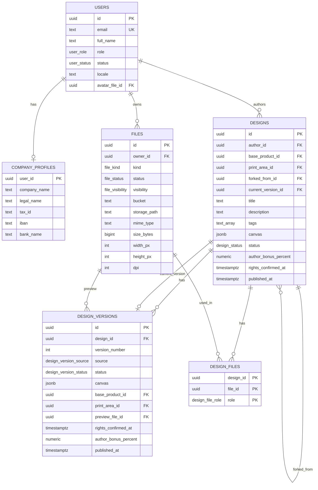
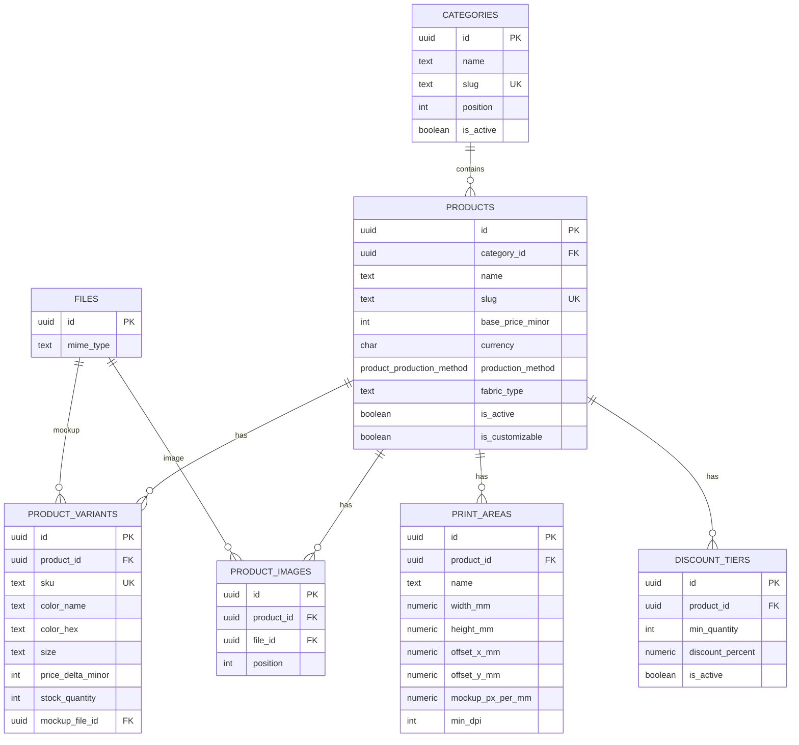
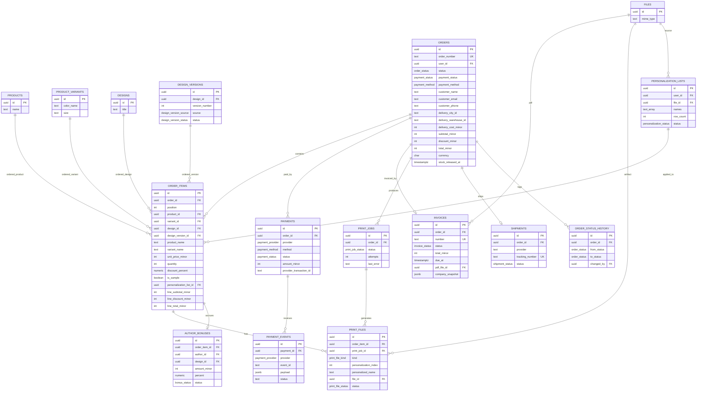
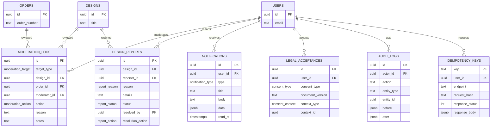

# Схема даних «Дизайнер»

Повний DDL: `schema.sql`. Цей файл пояснює призначення таблиць і зв'язки. Схема готова для Supabase PostgreSQL 15+.

## Огляд

29 таблиць у п'яти групах:

| Група | Таблиці |
| --- | --- |
| Користувачі та файли | `users`, `company_profiles`, `files` |
| Каталог | `categories`, `products`, `product_variants`, `print_areas`, `product_images`, `discount_tiers` |
| Дизайни | `designs`, `design_versions`, `design_files`, `personalization_lists` |
| Замовлення | `orders`, `order_items`, `payments`, `payment_events`, `invoices`, `print_jobs`, `print_files`, `shipments`, `order_status_history`, `author_bonuses` |
| Модерація та службові | `moderation_logs`, `design_reports`, `notifications`, `legal_acceptances`, `audit_logs`, `idempotency_keys` |

## Конвенції

- ID: UUID v4. Людські номери: `orders.order_number` (`ORD-YYYYMMDD-NNNNN`), `invoices.number` (`INV-YYYY-NNNNNN`).
- Гроші: `integer` у копійках, суфікс `_minor`. Ніяких `numeric` для грошей.
- Час: `timestamptz` у UTC. `created_at` і `updated_at` автоматичні.
- Файли: `files` є єдиним реєстром. Інші таблиці посилаються на `file_id`, не на URL.
- JSON: `designs.canvas` це Fabric.js JSON; `invoices.company_snapshot` це snapshot реквізитів; `audit_logs.before/after` це різниця станів.
- М'яке видалення: `users.deleted_at`, `designs.deleted_at`, `files.deleted_at`. Замовлення не видаляються.
- RLS: увімкнено на всіх таблицях. Backend використовує `service_role` і перевіряє права в Hono. Прямий доступ з `anon`/`authenticated` обмежений політиками.

## Діаграми

### Користувачі, файли, дизайни

### Каталог

### Замовлення, оплата, друк, доставка

### Модерація, сповіщення, аудит

## Правила цілісності

1. `designs.print_area_id` і `designs.base_product_id` мають складений FK. Зона друку обов'язково належить обраному товару.
2. `order_items.variant_id` і `order_items.product_id` мають складений FK. Варіант обов'язково належить товару.
3. `order_items.line_subtotal_minor`, `line_discount_minor`, `line_total_minor` є generated columns. Суми не можна розійтися з ціною, кількістю та знижкою.
4. `orders.total_minor` є generated column. Він завжди дорівнює `subtotal - discount + delivery`.
5. `recalculate_order_totals` перераховує `subtotal` і `discount` після будь-якої зміни `order_items` або `delivery_cost_minor`.
6. `validate_personalization_count` не дає створити позицію, де кількість імен не дорівнює кількості товару.
7. `enforce_design_publish_fields` не дає опублікувати дизайн без назви, canvas, підтвердження прав.
8. `prevent_last_admin_removal` не дає забрати роль або заблокувати останнього активного адміністратора.
9. `prevent_user_privilege_escalation` не дає користувачу змінити собі роль, статус або email через прямий доступ.
10. `payments_status_sync` переводить замовлення в `paid` або `refunded` на основі статусу платежу.
11. `order_status_history` пише кожен перехід статусу замовлення.
12. `print_jobs_active_uq` не дає мати два активні job для одного замовлення.
13. `protect_design_fields` не дає прямому користувачу змінити `author_bonus_percent`, лічильники або `published_at`.
14. `design_versions` має унікальну пару `(design_id, version_number)`. Версія без хоча б одного canvas-об'єкта не створюється.
15. `prevent_design_version_content_change` блокує зміну canvas, товару, зони друку, preview, прав і винагороди після `pending_moderation`.
16. `prevent_design_content_change` блокує зміну canvas, товару, зони друку, fork-посилання і винагороди після `pending_moderation`. Опублікований дизайн не повертається в редагування.
17. `protect_order_item_snapshot` робить позицію замовлення незмінною після створення: товар, варіант, ціна, кількість, знижка, версія дизайну і персоналізація.
18. `validate_order_item_design_version` перевіряє, що версія належить обраному дизайну і має статус `published` або `pending_moderation`.
19. `sync_design_current_version` після публікації author-версії оновлює `designs.current_version_id` і статус дизайну.
20. `designs` не може мати статус `published` без `current_version_id`.
21. `files.locked_at` фіксує файли, використані в незмінній версії. `DELETE /files/{id}` і cleanup job не видаляють locked-файли.

## Canvas contract

`designs.canvas` це Fabric.js JSON. Воно містить до 20 об'єктів:

- `image`: кілька зображень, кожне з `fileId`, `left`, `top`, `width`, `height`, `scaleX`, `scaleY`, `angle`, `flipX`, `flipY`, `opacity`, `zIndex`;
- `textbox`: `text`, `fontFamily` (5 hardcoded id), `fontSize`, `fontWeight`, `fontStyle`, `fill`, `textAlign`, `lineHeight`, `charSpacing`, `padding`, `splitByGrapheme` плюс ті самі transform-поля;
- `shape`: rect, circle, triangle, line, path.

`angle` приймає -360...360 і нормалізується до [0, 360). Усі `left`, `top`, `width`, `height`, `fontSize`, `padding` задані в пікселях canvas. `print_areas.mockup_px_per_mm` калібрує зону друку на mockup-зображенні: `mockupPx = mm * mockup_px_per_mm`. Backend друку рендерить ті самі Fabric.js об'єкти через Fabric.js + node-canvas у Node-сумісному worker-і або headless browser, тому перенос тексту й поворот збігаються з прев'ю.

## Стартові дані

`schema.sql` додає три глобальні знижки: 10 шт = 5%, 50 шт = 10%, 100 шт = 15%. Вони мають `product_id = null` і перекриваються товарними tier-ами. Інших демо-даних немає.

## Нотатки щодо міграцій

- Це fresh-install snapshot. Не редагуйте його після першого застосування в production.
- Кожна наступна зміна: `supabase/migrations/NNNN_description.sql`, append-only.
- Для локальної розробки: `supabase db reset`, потім застосуйте `schema.sql`.
- Для Supabase: перевірте, що `auth.users` існує до запуску. У Supabase він існує завжди.
- Якщо змінюєте enum, додавайте значення через `ALTER TYPE ... ADD VALUE`, не перестворюйте тип.
